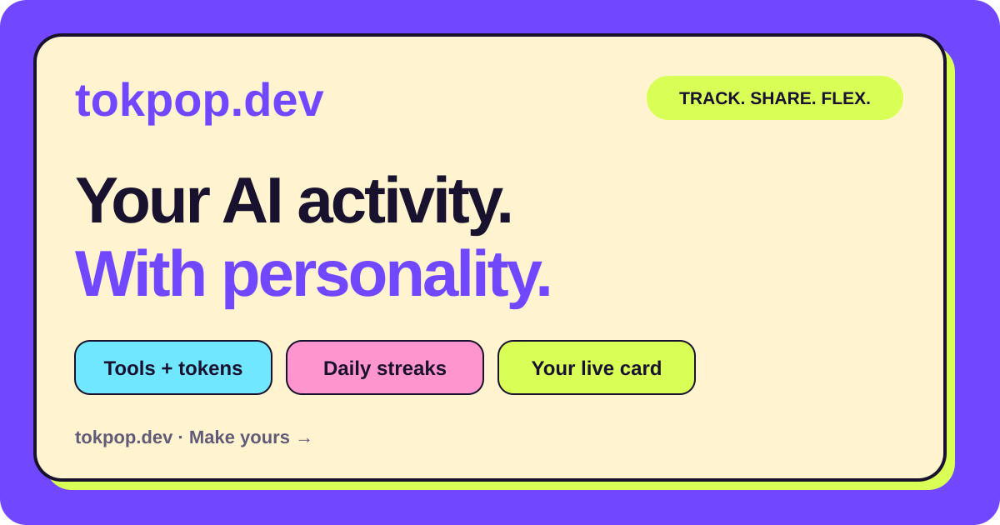

# tokpop.dev

## Your AI activity. With personality. 🥷

Track your AI workflow across coding tools: tokens by provider, daily breakdowns, and streaks. Turn it into a live GitHub README card worth showing off. **Track. Share. Flex.**

**[Make my card →](https://tokpop.dev/share)** · [⭐ Star this repo](https://github.com/Gaurav890/ai-native-profile)



https://github.com/user-attachments/assets/29d0bf6b-cd35-4520-bfb0-8356fa667cc0

[Watch video](https://github.com/user-attachments/assets/29d0bf6b-cd35-4520-bfb0-8356fa667cc0) · [Download MP4](public/media/launch-demo.mp4?raw=true)

*The 22-second walkthrough uses demo data and was recorded before the tokpop.dev rename.*

[](https://www.npmjs.com/package/ai-native-profile)
[](https://github.com/Gaurav890/ai-native-profile)
[](LICENSE)

Private until you publish. No prompts or source code in normal sync. No global install required.

Previously named AI Native Profile. The npm package remains `ai-native-profile` so existing collectors keep working. Moving the hosted app? Follow the [domain cutover checklist](docs/domain-setup.md).

## Make yours in three steps

1. **[Claim your card](https://tokpop.dev/share).** Sign in with GitHub. Your private starter card is ready without installing anything.
2. **Power up your stats.** On the card screen, copy your personalized connection command into Terminal. It detects supported coding tools; you approve the first sync and choose whether to enable automatic updates. Requires [Node.js](https://nodejs.org/) **22.13+**. The optional collector is downloaded and run through npm—not installed globally.
3. **Copy. Paste. Flex.** Pick a look, publish, and copy your card into your GitHub profile README. The image links to the make-your-own flow so visitors can create theirs, too. Joining the leaderboard is a separate opt-in.

Just exploring? You can publish the GitHub-only starter card and add coding stats later.

## What you get

| The fun part | What is actually behind it |
| --- | --- |
| 🃏 A live README card | Your build alter ego, tool totals, active days, and streak—not a static screenshot. |
| 🔎 Token receipts | Per-provider totals and day-by-day breakdowns, with coverage and estimated data labelled. |
| 🔥 Your build rhythm | Activity history and streaks across supported coding tools. |
| 🚀 GitHub activity | Contribution totals for the latest 90-day window, separate from coding-token usage. |
| 🏆 An optional leaderboard | A public scoring formula. Spending more tokens does **not** increase your score. |

## Which tools work?

**Codex · Claude Code · Cursor · Gemini CLI · GitHub Copilot CLI**, plus GitHub activity.

The collector uses supported account data or records retained on your computer. Coverage varies by tool, version, and available history; detecting a tool does not guarantee a complete lifetime total. Claude Code includes reported input, output, cache-write, and cache-read tokens; some historical daily allocations are estimates.

See the [provider capability matrix](docs/providers.md) for collection methods, limitations, and scoring eligibility.

## The questions you probably have

### Do I need to keep running a command?

Not if you enable automatic updates. After the first sync, the collector offers a **15-minute background schedule on macOS or Linux**. It continues after Terminal closes, while your computer is awake and connected. This requires your approval; pairing alone does not turn it on.

The README image reflects synced data, but GitHub's image cache can delay visible updates. It is not a real-time counter.

<details>
<summary>Show manual sync, status, and stop commands</summary>

Run these from any folder. You do not need to clone this repository.

```bash
# Check pairing, sources, and automatic updates
npm exec --yes --package=ai-native-profile@latest -- ai-native-profile doctor

# Sync once
npm exec --yes --package=ai-native-profile@latest -- ai-native-profile sync

# Enable persistent updates
npm exec --yes --package=ai-native-profile@latest -- ai-native-profile watch --install

# Disable persistent updates
npm exec --yes --package=ai-native-profile@latest -- ai-native-profile watch --uninstall

# Disable updates and remove the local pairing
npm exec --yes --package=ai-native-profile@latest -- ai-native-profile disconnect
```

Full usage and troubleshooting: [collector README](packages/cli/README.md).

</details>

### What leaves my computer?

Normal sync sends **aggregate activity**: dates, provider/model identifiers, usage counts, and coverage information. It does **not** send prompts, responses, source code, shell commands, repository names, file paths, cookies, or provider credentials.

Want to inspect the payload before connecting?

```bash
npm exec --yes --package=ai-native-profile@latest -- ai-native-profile preview
```

Your dashboard starts private. Publishing your profile, joining the leaderboard, and sharing an individual session are separate choices. [Read the privacy boundary →](docs/privacy.md)

### Why might my token total differ from another tool?

Providers count usage differently, cached tokens matter, and local history can be missing. Counts represent the **covered records**, not a guaranteed lifetime or billing total. Check the provider breakdown and coverage dates before comparing numbers; estimated values are labelled, not presented as exact.

If something looks wrong, [report it](https://github.com/Gaurav890/ai-native-profile/issues/new) with the collector version, operating system, affected tool, and a redacted error. **Do not attach raw conversations, credentials, or unredacted logs.**

### Is the score a measure of developer skill?

No. The 0–100 Workflow Index measures eligible activity across consistency, workflow depth, provider breadth, and GitHub delivery. It does not measure code quality, productivity, or whether a specific commit was written with AI. Raw token volume and estimated metrics do not affect rankings. [See the formula →](docs/methodology.md)

### Does it read my browser chat history?

No. Experimental ChatGPT Web and Claude Web support is separate from the main coding flow. It only covers approved, locally parsed exports or explicitly invoked MCP activity—not silent history access—and does not affect rankings.

## Like the idea? Help it spread. ⭐

**Use the Star button at the top of this repository** to support the project and find it again. Then put your own card in your README—that is the best demo someone else can discover.

[Make my card](https://tokpop.dev/share) · [Report a bug or suggest a feature](https://github.com/Gaurav890/ai-native-profile/issues/new)

## Build with us

Bug reports, clearer docs, and fixes for provider coverage are welcome. Open an issue with a reproducible example or send a focused pull request. Collector fixtures must be redacted: see the [fixture rules](docs/fixtures.md) and [adapter guide](docs/adapter-guide.md).

<details>
<summary>Local development and checks</summary>

Requires Node.js 22.13+, pnpm 9.15.9, PostgreSQL, and a GitHub OAuth App.

```bash
git clone https://github.com/Gaurav890/ai-native-profile.git
cd ai-native-profile
pnpm install
cp .env.example .env.local
```

Set `DATABASE_URL`, `SESSION_SECRET`, `GITHUB_CLIENT_ID`, `GITHUB_CLIENT_SECRET`, and `PUBLIC_APP_URL=http://localhost:3000` in `.env.local`. Configure the OAuth callback as `http://localhost:3000/api/auth/github/callback`. Leave `BACKEND_URL` unset for a single local server.

```bash
pnpm db:migrate
pnpm dev
```

Open `http://localhost:3000`. To pair the local collector with your local server:

```bash
ANP_API_URL=http://localhost:3000 pnpm cli connect
```

Before submitting a change:

```bash
pnpm test
pnpm typecheck
pnpm lint
pnpm build
```

Use `pnpm db:generate` and `pnpm db:migrate` when changing the database schema. Never commit `.env.local` or credentials.

</details>

<details>
<summary>Repository map and deeper docs</summary>

```text
app                   Web experience and API routes
packages/cli          Pairing, discovery, sync, and diagnostics
packages/adapters     Provider collectors and export aggregation
packages/schema       Versioned activity contract
packages/scoring      Transparent scoring implementation
packages/renderers    README and social card renderers
db                    PostgreSQL schema and migrations
docs                  Privacy, methodology, deployment, and guides
public/media          README poster and launch video
```

[Self-hosting](docs/self-hosting.md) · [Deployment](docs/deployment.md) · [Threat model](docs/threat-model.md) · [Collector releases](docs/cli-release.md) · [Roadmap](docs/roadmap.md)

The hosted architecture uses Vercel for the web surface and Railway for the API and PostgreSQL. Device signatures protect continuity and integrity in transit; they do not make a user-controlled computer tamper-proof.

</details>

## License

[MIT](LICENSE). Provider names describe compatibility, not endorsement. tokpop.dev is provider-neutral.
